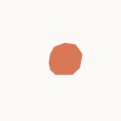
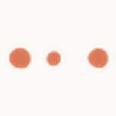
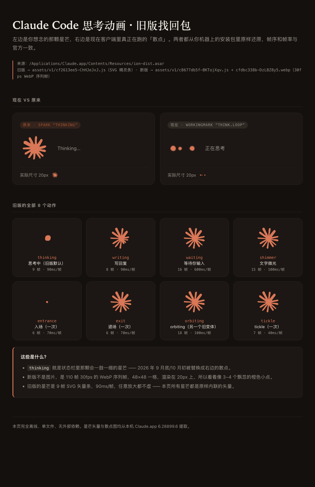

# Claude Code — Classic Spark

**[中文](#中文) · [English](#english)**

<table>
  <tr>
    <td align="center" width="50%">
      <br>
      <sub><b>经典星芒 · classic spark</b><br>9 帧 / 90ms · 2026 年 9 月之前</sub>
    </td>
    <td align="center" width="50%">
      <br>
      <sub><b>现在的散点 · current dots</b><br>110 帧 / 30fps · 替换它的那版</sub>
    </td>
  </tr>
</table>

<p align="center"><sub>左边是原来的「思考中」，右边是目前在跑的那版。两个动图都是从安装包里原样还原的，帧序和帧率与官方一致。</sub></p>

> **这是公开归档。** 素材是 Anthropic 的美术作品，本仓为非官方归档 —— 详见 [NOTICE.md](NOTICE.md)。
>
> **想在自己的客户端里用？** 配套插件 **[dsh-spark-motion](https://github.com/Dos7t3r/dsh-spark-motion)** 可以在 DeepSeek Harness 的设置里一键切换这三套动画（原版 / 经典星芒 / 新版散点）；本仓的 `tools/` 也能把整包素材从你自己的安装包里重新生成。

---

## 中文

### 这是什么

2026 年 9 月底至 10 月初，Claude Desktop 里 **Claude Code 标签页的「思考中」指示器**被换掉了：

- **原来**：一颗会一鼓一缩的星芒 —— `Spark` 组件，**9 帧、90ms/帧的 SVG 矢量序列帧**
- **现在**：3～4 个飘忽的橙色小圆点 —— `WorkingMark` 组件，**110 帧、30fps 的 WebP 序列帧**，48×48 一格渲染到 20px

旧素材并没有被删，它**仍然完整地打包在当前安装包内部**，只是不再被调用。本仓把旧素材完整还原出来，并记录了改版机制、代码证据和复现方法。



### 内容清单

| 路径 | 内容 |
|---|---|
| `claude-spark.html` | 单文件离线页：新旧并排对比 + 旧版 8 个动作全部动起来（无外部依赖） |
| `assets/` | 动图成品：`claude-thinking.*`（旧星芒）、`claude-new-think-dots.*`（现在的散点，对照用）等 |
| `frames/` | **8 个状态全部 85 帧**，单帧 SVG，矢量，任意放大不虚 |
| `evidence/` | 逐帧总览图、新版散点 110 帧、页面预览 |
| `original/` | 官方原始模块（归档对照用，见 [NOTICE.md](NOTICE.md)） |
| `tools/` | `extract-asar.py` 解包器 + `rebuild.mjs` 一键重建（Node 18+，零依赖） |

### 技术细节

| | 旧版 | 现在 |
|---|---|---|
| 组件 | `Spark`（`data-cds="Spark"`） | `WorkingMark`（`data-cds="WorkingMark"`） |
| 代码位置 | `ion-dist.asar → assets/v1/cf2613ee5-ChHJeJxJ.js` | `assets/v1/c8677db5f-BKTojXqv.js` |
| 素材形态 | 内联 SVG 竖排精灵条，`translateY(-n%)` + `steps()` | WebP 精灵图，48×48 一格 |
| 帧率 | 90ms/帧（`thinking`） | 33.33ms/帧（30fps） |
| 渲染尺寸 | 20px | 20px |
| 颜色 | `currentColor` | `var(--cds-clay)` = `#D97757` |

另外三个动作也有动图：`assets/claude-writing.gif`、`assets/claude-waiting.gif`、`assets/claude-orbiting.gif`（星芒收束成旋转环的那版变体）。

旧版 8 个状态的帧率：

```
thinking   9 帧 @ 90ms     writing   8 帧 @ 90ms
waiting   16 帧 @600ms     shimmer  15 帧 @100ms
entrance   6 帧 @ 70ms     exit      6 帧 @ 70ms
orbiting  18 帧 @100ms     tickle    7 帧 @ 40ms
```

新版 `think` 三段：`think.in` 16 帧 / `think.loop` 110 帧（`rest=95`）/ `think.out` 15 帧，全部 33.33ms。

### 切换靠服务端灰度，不是本地设置

```js
function Iv(e){ return e ? "clay" : "sprite" }   // clay = 新散点，sprite = 旧星芒
function Rv(e){
  let t = um("turnStatusOwnsSpark"),
      n = um("turnStatusActivityMarks"),
      r = Iv(e && t && n);
  return e && !t ? "classic" : r
}
```

相关开关：`turnStatusOwnsSpark`、`turnStatusActivityMarks`、`turnStatusSessionRowMarks`、`turnStatusTreatment`，实验位 `__gb__2346508742`。这些值由服务端下发后进内存 store，`Local Storage/leveldb`、`IndexedDB`、`Application Support/Claude` 里都没有落盘缓存。

### 能改回客户端里吗

**不改动客户端本体：不能。** 三条路都堵：

1. **没有本地开关** —— 上面那几个 flag 没有可编辑的落盘文件；
2. **降级无效** —— gate 在服务端，退回旧版仍会被下发成散点；
3. **不能改包** —— `Info.plist` 里有 `ElectronAsarIntegrity`（`app.asar` 和 `ion-dist.asar` 各一个 SHA256），动画代码正好在 `ion-dist.asar` 里。改内容校验对不上，重签名又丢 Anthropic PBC 的 Developer ID 签名和硬化运行时，而且每次自动更新都要重做。

唯一有效的动作是去顶官方 issue：**`anthropics/claude-code#98254`**（2026-09-29 开，标题 "[Desktop] Bring back the animated Claude spark as the working indicator"，目前仍 open）。

### 自己复现

```bash
# 1) 解包（只解 assets/v1，约 1 秒）
python3 tools/extract-asar.py \
  /Applications/Claude.app/Contents/Resources/ion-dist.asar \
  extract ./_ion /assets/v1

# 2) 重建 frames/ + claude-spark.html
node tools/rebuild.mjs ./_ion --dots ./original/cfdbc338b-DzLBZ8y5.webp
```

`rebuild.mjs` 按**内容**而不是文件名定位模块（Vite 每次构建都会改 hash），所以客户端更新后照样能用。

动图（GIF/WebP）的导出用 headless Chrome 逐帧截图 + Pillow 合成，不是必要步骤，`frames/*.svg` 已足够。

### 法律与边界

- **动画素材的著作权归 Anthropic**。自己提取、研究、本地使用，和**公开再分发别人的美术资源**是两件事；公开版里保留这些素材有被 DMCA 下架的风险，虽然实际风险不高。
- **反向工程可能触及服务条款**（对客户端做拆包分析）。这不是法律意见。
- **商标**：本仓是非官方归档，与 Anthropic 无关联；出现 "Claude" 仅作说明性使用。
- **如果想公开**：删掉 `original/`、`assets/`、`frames/`、`evidence/`，保留 `tools/` + 本文档。这样公开的是「方法和分析」，素材由使用者从自己的安装包生成 —— 这是这类项目通行的干净做法。
- 本仓不含任何 token、账号信息或你机器上的路径之外的隐私数据。

---

## English

### What this is

The two animations above, side by side: the nine-frame spark that Claude Desktop used before late
September 2026, and the 110-frame 30fps dot animation that replaced it. Both are reproduced from the
shipped bundle at native frame order and timing.

Late September / early October 2026, the **"thinking" indicator in the Claude Code tab of Claude Desktop** was replaced:

- **Before**: a pulsing starburst spark — the `Spark` component, **9 SVG vector frames at 90ms/frame**
- **After**: 3–4 drifting orange dots — the `WorkingMark` component, a **110-frame, 30fps WebP sprite sheet** (48×48 cells rendered at 20px)

The old assets were never removed. They are **still shipped inside the current bundle**, just no longer referenced. This repo recovers them exactly, and documents the switch, the code evidence, and how to reproduce it.

### Contents

| Path | What |
|---|---|
| `claude-spark.html` | Offline single-file comparison page: before/after side by side, all 8 old states animated |
| `assets/` | Rendered animations (GIF/WebP): the classic spark, plus the current dots for comparison |
| `frames/` | **All 85 frames across 8 states**, standalone SVGs (vector, scales cleanly) |
| `evidence/` | Frame-by-frame contact sheets and page preview |
| `original/` | The upstream modules as shipped (see [NOTICE.md](NOTICE.md)) |
| `tools/` | `extract-asar.py` (asar unpacker) + `rebuild.mjs` (one-command rebuild, Node 18+, zero deps) |

### Frame rates

```
thinking   9 @ 90ms    writing   8 @ 90ms    waiting  16 @600ms    shimmer 15 @100ms
entrance   6 @ 70ms    exit      6 @ 70ms    orbiting 18 @100ms    tickle   7 @ 40ms
```

Current `think`: `think.in` 16 frames / `think.loop` 110 frames (`rest=95`) / `think.out` 15 frames, all 33.33ms.

### The switch is a server-side flag, not a setting

```js
function Iv(e){ return e ? "clay" : "sprite" }   // clay = new dots, sprite = classic spark
function Rv(e){
  let t = um("turnStatusOwnsSpark"),
      n = um("turnStatusActivityMarks"),
      r = Iv(e && t && n);
  return e && !t ? "classic" : r
}
```

Flags involved: `turnStatusOwnsSpark`, `turnStatusActivityMarks`, `turnStatusSessionRowMarks`, `turnStatusTreatment`, experiment slot `__gb__2346508742`. They arrive from the server into an in-memory store — no cache on disk in `Local Storage/leveldb`, `IndexedDB`, or `Application Support/Claude`.

### Can it be restored?

**Not without modifying the app itself.** All three routes are closed:

1. **No local switch** — the flags above have no editable on-disk representation.
2. **Downgrading doesn't help** — the gate is server-side; an older build still receives "clay".
3. **The bundle can't be patched sanely** — `Info.plist` carries `ElectronAsarIntegrity` SHA256 hashes for both `app.asar` and `ion-dist.asar`, and the indicator code lives in `ion-dist.asar`. Editing breaks the integrity check; re-signing loses Anthropic PBC's Developer ID signature and hardened runtime, and every auto-update would undo it.

The only productive move is to upvote **`anthropics/claude-code#98254`** (opened 2026-09-29, still open).

### Rebuild it yourself

```bash
python3 tools/extract-asar.py \
  /Applications/Claude.app/Contents/Resources/ion-dist.asar \
  extract ./_ion /assets/v1

node tools/rebuild.mjs ./_ion --dots ./original/cfdbc338b-DzLBZ8y5.webp
```

`rebuild.mjs` locates the module **by content, not filename** (Vite rehashes filenames every build), so it keeps working after client updates.

The GIF/WebP renders were produced with headless Chrome frame capture + Pillow; that step is optional — `frames/*.svg` is the source of truth.

### Legal

- **The artwork is Anthropic's.** Extracting it for personal study/use is not the same as **publicly redistributing** it; keeping the assets in a public repo carries a DMCA takedown risk (modest, but real).
- **Reverse engineering** may run against the Terms of Service. Not legal advice.
- **Trademark**: unofficial archive, unaffiliated with Anthropic; "Claude" is used descriptively.
- **This repo currently ships the artwork** (it is a public archive). If you only want the method and the analysis, drop `original/`, `assets/`, `frames/`, `evidence/` and keep `tools/` + this README — each user then regenerates the assets from their own installation, the conventional clean approach for this kind of project.
- No tokens, credentials, or personal data are included.

---

## 来源 / Provenance

Extracted 2026-11-21 from a locally installed **Claude Desktop 6.28899.6**
(`com.anthropic.claudefordesktop`) → `Contents/Resources/ion-dist.asar`.
Bundled Claude Code: 2.1.330.

Upstream issue: [anthropics/claude-code#98254](https://github.com/anthropics/claude-code/issues/98254)

## 许可 / License

Code and documentation: **MIT** (see [LICENSE](LICENSE)).
Animation artwork: **© Anthropic** — not covered by that license (see [NOTICE.md](NOTICE.md)).
